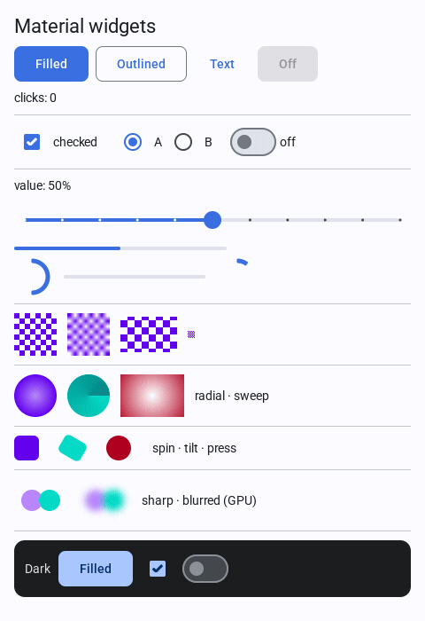
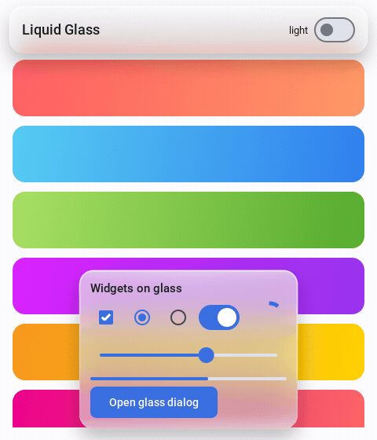

# compose-ui

[](https://github.com/philnguyen/lean-compose-ui/actions/workflows/lean_action_ci.yml)

A [Jetpack Compose](https://github.com/jetbrains/compose-multiplatform)-style
declarative UI framework for [Lean 4](https://lean-lang.org), rendered
via [lean-sdl3](https://github.com/philnguyen/lean-sdl3). It
ships a full animation system, a Material-lite widget set, a UI-test
framework, and all [7GUIs tasks](https://eugenkiss.github.io/7guis/tasks)
as demos.

<p align="center">
  
  
</p>

## Highlights

- **Full animation system** — easing, tween/spring/keyframes specs,
  `Animatable` with velocity-preserving interruption, `animate*AsState`,
  `Transition`, `AnimatedVisibility`.
- **Material-lite widgets** — light/dark theming, ripple, the standard
  controls (`Button`, `Checkbox`, `Switch`, `Slider`, `TextField`, …),
  scroll, lazy lists, popups, menus, and dialogs.
- **Two render backends** — a GPU backend (the default) with instanced SDF
  shapes (circular or Apple-squircle corners), elevation shadows, real
  layers, blur, true per-panel backdrop blur with refractive edges
  (liquid-glass), and exact rounded clipping;
  and a CPU backend (`COMPOSE_BACKEND=sdl`) that runs headless — all tests
  use it. Both draw the same recorded display list.
- **Desktop components** — declarative multi-window `application` with
  `Window`/`DialogWindow`, menu bars, context menus, tooltips, and a
  system `Tray`.
- **MT UI-test framework** (`Compose.Test`) — a headless
  `androidx.compose.ui.test` analog: a semantics tree, matcher-first finders,
  and actions synthesized through the *real* input router, with a fake clock.
- **Demos** — all seven 7GUIs tasks, including Cells (a virtualized formula
  spreadsheet), plus a file manager.

## Quick start

```sh
brew install sdl3 sdl3_ttf     # macOS; Linux: build SDL3 + SDL3_ttf from source
lake build
lake exe gallery               # interactive launcher for every demo
SDL_VIDEO_DRIVER=dummy SDL_AUDIO_DRIVER=dummy lake exe test
```

Run a demo directly with `lake exe <name>`:

```
demo-widgets   demo-overlays  demo-glass    demo-counter  demo-tempconv
demo-flight    demo-timer     demo-crud     demo-circles  demo-cells
demo-desktop   demo-files     demo-smoke
```

## Your first app

A counter — a read-only field and an increment button (7GUIs #1). This is the
`demo-counter` source, verbatim:

```lean
import Compose
open Compose

/-- A read-only field showing a remembered count, and a button to bump it. -/
composable def counterUi : Composable Unit := do
  let count ← remember (mutableStateOf (0 : Nat))
  let n ← count.get
  Column (modifier := Modifier.padding (all := 16))
      (verticalArrangement := .spacedBy 12) do
    Text "Counter" (style := { fontSize := 22 })
    TextField (toString n) (fun _ => pure ()) (enabled := false)
      (modifier := Modifier.testTag "count")
    Button (count.modify (· + 1)) (Text "Count")
      (modifier := Modifier.testTag "count-btn")

def main : IO UInt32 :=
  runMaterialApp "compose counter" 320 200 counterUi
```

`remember (mutableStateOf …)` survives recomposition; writing it
(`count.modify`) re-runs only the scopes that read it. `Modifier.testTag`s are
handles for the tests below. `runMaterialApp` installs the Material theme
around your screen and follows the OS light/dark setting, live — pass
`theme := .fixed .dark` to pin one instead.

## Testing

UI behavior is tested with the MT framework: tag your widgets, boot with
`runComposeTest`, and drive matcher-first verbs through the real input path.

```lean
import Compose
open Compose Compose.Test

/-- Clicking "Count" increments the read-only field. -/
def increment : IO Unit := runComposeTest counterUi do
  assertTextEquals (.tag "count") "0"
  click (.tag "count-btn")
  assertTextEquals (.tag "count") "1"
  advanceTimeBy 150               -- the fake clock only moves when told
```

Clicks/keys/text go through the same router the app uses; the clock is frozen
until you `advanceTimeBy`/`settle`, so animations are deterministic. Failures
dump the semantics tree. Real-device input is regression-tested by record &
replay: `COMPOSE_INPUT_RECORD=<path>` dumps an app's input as JSONL, and the
`Replay` tests drive committed recordings back through the router. See
`test/ComposeTests/UiTest.lean` for worked examples.

## Project layout

```
Compose/Core/        pure kernel: Color, geometry, Dp/Sp/Density (SDL-free)
Compose/Runtime/     state, composer/slot tree, effects, the composable macro
Compose/Animation/   easing, springs, Animatable, transitions
Compose/Ui/          layout, modifiers, draw, text, input, window/app loop
Compose/Foundation/  Row/Column/Box, scroll, lazy lists, gestures
Compose/Material/    theme + widgets
Compose/Test/        the MT UI-test framework
Demos/               7GUIs demos + the gallery launcher
test/ComposeTests/   runtime + MT test groups
```

Layer discipline is absolute: `Runtime` never imports `Sdl`; `Ui` never
imports `Material`.

## Contributing

Start with [`AGENTS.md`](AGENTS.md) (build/run/test, coding style, the
demo-shim and MT-test conventions), then [`docs/DESIGN.md`](docs/DESIGN.md)
(the settled architecture) and [`docs/ROADMAP.md`](docs/ROADMAP.md)
(milestones). No warnings, no `sorry`; every public declaration gets a doc
comment.

## License

Apache-2.0 ([`LICENSE`](LICENSE)).

API design and behavior are modeled on
[Jetpack Compose](https://developer.android.com/jetpack/compose)
(Copyright The Android Open Source Project) and
[Compose Multiplatform](https://github.com/jetbrains/compose-multiplatform)
(Copyright JetBrains s.r.o.), both licensed under Apache-2.0.

Bundled fonts: Roboto and Noto Emoji are OFL-1.1, Twemoji Mozilla is
Apache-2.0 (code) / CC-BY 4.0 (artwork) — see `assets/fonts/`.
