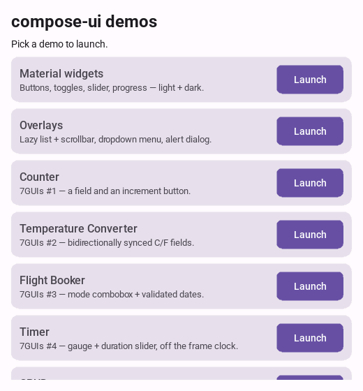
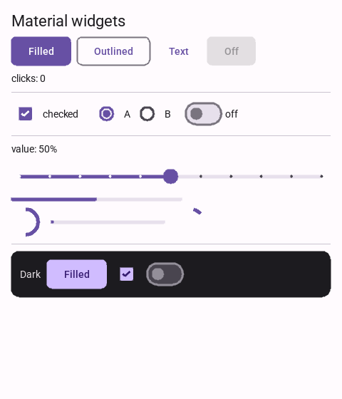
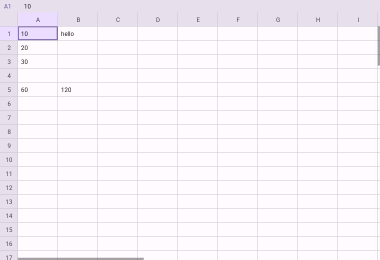
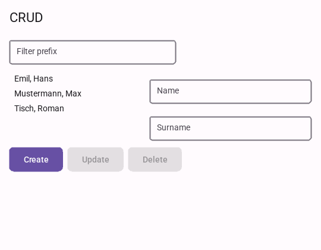
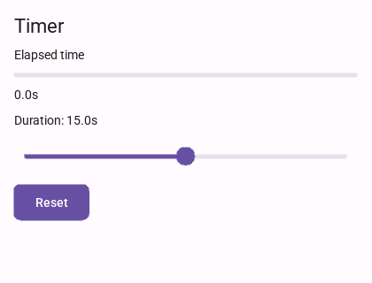
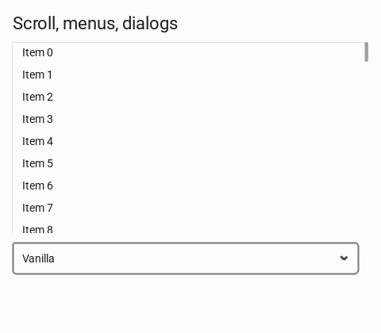

# compose-ui

A [Jetpack Compose](https://github.com/jetbrains/compose-multiplatform)-style
declarative UI framework for [Lean 4](https://lean-lang.org), rendered with
SDL3 via [lean-sdl3](https://github.com/philnguyen/lean-sdl3). You write
composable functions; a positional-memoization runtime recomposes exactly the
scopes whose state changed, remeasures the affected layout, and redraws. It
ships a full animation system, a Material-lite widget set, a UI-test
framework, and all seven [7GUIs tasks](https://eugenkiss.github.io/7guis/tasks)
as demos.

<p align="center">
  
  
  
</p>
<p align="center">
  
  
  
</p>

## Highlights

- **Positional-memoization runtime** — a slot-tree composer with `remember`,
  `keyed`, `CompositionLocal`, and effects; state writes invalidate only the
  reading scopes, layout dirties only the affected nodes.
- **`composable` macro** — auto group keys for `if`/`match`/`for`,
  skippability via structural equality, restartable scopes.
- **Full animation system** — easing, tween/spring/keyframes/repeat specs,
  `Animatable` (velocity-preserving interruption), `animate*AsState`,
  `Transition`, `AnimatedVisibility`.
- **Material-lite widgets** — theme (light/dark schemes, typography, shapes),
  state layers + bounded ripple, `Button`/`Checkbox`/`RadioButton`/`Switch`/
  `Slider`/`ProgressIndicator`/`TextField`, scroll, lazy lists, popups,
  dropdown menus, dialogs.
- **MT UI-test framework** (`Compose.Test`) — a headless
  `androidx.compose.ui.test` analog: a semantics tree, matcher-first finders,
  and actions synthesized through the *real* input router, with a fake clock.
- **7GUIs demos** — Counter, Temperature Converter, Flight Booker, Timer,
  CRUD, Circle Drawer, and Cells (a virtualized formula spreadsheet).

## Quick start

```sh
brew install sdl3 sdl3_ttf     # macOS; Linux: build SDL3 + SDL3_ttf from source
lake build
lake exe gallery               # interactive launcher for every demo
SDL_VIDEO_DRIVER=dummy SDL_AUDIO_DRIVER=dummy lake exe test
```

Run a demo directly with `lake exe <name>`:

```
demo-widgets   demo-overlays  demo-counter  demo-tempconv  demo-flight
demo-timer     demo-crud      demo-circles  demo-cells     demo-smoke
```

## Your first app

A counter — a read-only field and an increment button (7GUIs #1). This is the
`demo-counter` source, verbatim:

```lean
import Compose
open Compose

/-- A read-only field showing a remembered count, and a button to bump it. -/
composable def counterUi : Composable Unit := do
  let count ← remember (mutableStateOf (0 : Nat))
  let n ← count.get
  MaterialTheme (content :=
    Column (Modifier.padding (all := 16)) (verticalArrangement := .spacedBy 12)
      (content := do
        Text "Counter" (style := { fontSize := 22 })
        TextField (toString n) (fun _ => pure ()) (enabled := false)
          (modifier := Modifier.testTag "count")
        Button (count.modify (· + 1)) (modifier := Modifier.testTag "count-btn")
          (content := Text "Count")))

def main : IO UInt32 :=
  runApp "compose counter" 320 200 counterUi
```

`remember (mutableStateOf …)` survives recomposition; writing it
(`count.modify`) re-runs only the scopes that read it. `Modifier.testTag`s are
handles for the tests below.

## Testing

UI behavior is tested with the MT framework: tag your widgets, boot with
`runComposeTest`, and drive matcher-first verbs through the real input path.

```lean
import Compose
open Compose Compose.Test

/-- Clicking "Count" increments the read-only field. -/
def increment : IO Unit := runComposeTest (content := counterUi) do
  assertTextEquals (.tag "count") "0"
  click (.tag "count-btn")
  assertTextEquals (.tag "count") "1"
  advanceTimeBy 150               -- the fake clock only moves when told
```

Clicks/keys/text go through the same router the app uses; the clock is frozen
until you `advanceTimeBy`/`settle`, so animations are deterministic. Failures
dump the semantics tree. See `test/ComposeTests/UiTest.lean` for worked
examples.

## Project layout

```
Compose/Core/        pure kernel: Color, geometry, Dp/Sp/Density (SDL-free)
Compose/Runtime/     state, composer/slot tree, effects, the composable macro
Compose/Animation/   easing, springs, Animatable, transitions
Compose/Ui/          layout, modifiers, draw, text, input, window/app loop
Compose/Foundation/  Row/Column/Box, scroll, lazy lists, gestures
Compose/Material/    theme + widgets
Compose/Test/        the MT UI-test framework
Demos/               7GUIs demos + the gallery launcher
test/ComposeTests/   runtime + MT test groups
```

Layer discipline is absolute: `Runtime` never imports `Sdl`; `Ui` never
imports `Material`.

## Contributing

Start with [`AGENTS.md`](AGENTS.md) (build/run/test, coding style, the
demo-shim and MT-test conventions), then [`docs/DESIGN.md`](docs/DESIGN.md)
(the settled architecture) and [`docs/ROADMAP.md`](docs/ROADMAP.md)
(milestones). No warnings, no `sorry`; every public declaration gets a doc
comment.

## License

Apache-2.0 ([`LICENSE`](LICENSE)). Bundled Roboto fonts are OFL-1.1
(`assets/fonts/`).
